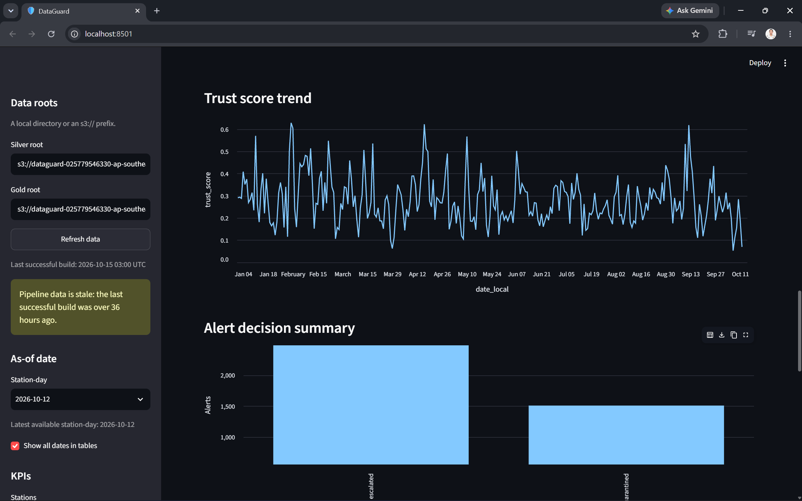

# DataGuard: Trust-Aware Anomaly Detection for Untrusted Data Pipelines

**PRT661 - Data Science Practice | Charles Darwin University | Semester 2, 2026**

DataGuard helps an analyst distinguish an unusual air-quality measurement from
an unreliable data feed. It processes the OpenAQ archive, checks data health,
detects unusual station-day patterns, and presents the evidence in a Streamlit
dashboard.

Two layers run independently: **Layer 1 checks the data**, while **Layer 2 looks
for events**. Fusion then applies a quality penalty to each event score. An
alert with a quality incident on the same station and local day is
**quarantined**; other alerts are **escalated**. Both remain visible so a
potential event is never silently removed by the trust policy.



*Dashboard snapshot using the expanded 2026 dataset. The image shows a saved
build completed on 15 October 2026, including the dashboard's stale-data
warning; it is not a live status display.*

## Progress since Assessment 3

- **Longer data coverage:** extended the January-March collection with
  April-October 2026 observations in S3, with the expanded results available in
  the dashboard's trends and alerts.
- **Model persistence and history:** save the latest fitted models and a
  timestamped copy for each run, alongside build metadata and model-run trends.
  The model-persistence and initial evaluation work was integrated from `main`.
- **More reliable evaluation:** split raw readings by date before fitting
  baselines and models, record input fingerprints and versions, and distinguish
  weak-label agreement from measured event accuracy.
- **Missing days made visible:** Layer 1 now includes bronze manifest attempts,
  so a completely missing daily file can still produce a quality finding even
  when there are no silver readings for that day.
- **Controlled technical checks:** added synthetic data-quality faults,
  fusion-policy scenarios, dashboard evidence checks, and a read-only verifier
  for the frozen end-to-end snapshot.
- **Explain one alert:** inspect detector votes, feature values, measurements,
  previous-seven-day context, quality incidents, and the saved trust calculation;
  download the evidence as JSON.
- **Assessment evidence:** assembled the final report, screenshots, project
  update summary, and technical evidence for the assessment handover.

The [technical progress log](docs/assessment4-progress.md) records the five
implementation steps, commands, results, and their limitations.

## End-to-end architecture

The lake follows **bronze -> silver -> gold**. Each stage reads materialised
outputs, and the two detectors meet only at fusion.

| Stage | Reads | Writes | Purpose |
|---|---|---|---|
| `ingest` | OpenAQ public archive | `bronze/` | Copy daily `.csv.gz` files unchanged and record successful and missing-file attempts in the arrival manifest. |
| `conform` | `bronze/` | `silver/` | Harmonise names, units and timestamps; consolidate duplicate reading keys while retaining negative and stuck values. |
| `quality` | `silver/` + `bronze/` | `gold/layer1/` | Build sensor-day and station-day metrics, apply quality rules, and fit an Isolation Forest when enough history is available. |
| `detect` | `silver/` | `gold/layer2/` | Build station-day features and combine Isolation Forest, Local Outlier Factor and DBSCAN votes into ranked alerts. |
| `fuse` | Layer 1 + Layer 2 gold | `gold/fusion/` | Retain every candidate, calculate trust, and assign escalated or quarantined status. |

`trust_score = alert_score * (1 - quality_penalty)`, with penalties of 0.2,
0.4 and 0.7 for low, medium and high severity. The highest severity applies;
penalties do not stack. These scores are ranking and policy values, not
probabilities of a real pollution event.

Layer 1 reads bronze because file arrival, missing files and schema changes
cannot be established from readings alone. Fusion is alert-driven: days with
only quality findings remain available in the health and map views as
`quality_only`, without inventing an event alert.

See the [architecture](docs/architecture.md),
[pipeline walkthrough](docs/pipeline.md), and [fusion specification](models/fusion_spec.md).
Counts in older walkthrough examples describe their original snapshots.

## Run locally

From the repository root, using PowerShell:

```powershell
python -m venv venv
.\venv\Scripts\python.exe -m pip install -r requirements-dev.txt
if (!(Test-Path .env)) { Copy-Item .env.example .env }

# Explicit local roots take precedence over S3 settings in .env.
$env:BRONZE_ROOT = "data/bronze"
$env:SILVER_ROOT = "data/silver"
$env:GOLD_ROOT = "data/gold"
$env:MODELS_ROOT = "models"

.\venv\Scripts\python.exe -m pipelines run `
  --locations 1544061 1601414 2455394 6430870 `
  --start 2026-01-01 --end 2026-01-31

.\venv\Scripts\python.exe -m streamlit run dashboard/app.py
```

The dashboard opens at `http://localhost:8501`. Archive ingestion needs an
internet connection, but local processing and the dashboard need no AWS account.
For a runtime-only installation, use `requirements.txt`. On macOS/Linux, use
`venv/bin/python` and the equivalent environment-variable syntax.

Stages can also run separately against the configured roots:

```powershell
.\venv\Scripts\python.exe -m pipelines conform
.\venv\Scripts\python.exe -m pipelines quality
.\venv\Scripts\python.exe -m pipelines detect
.\venv\Scripts\python.exe -m pipelines fuse
```

Layer 1's model needs at least 14 station-days for an eligible station; its
rules still run below that threshold. Layer 2's ensemble needs at least 20
feature rows and reports skipped fits when there is insufficient history.

## Dashboard

| View | What an analyst can inspect |
|---|---|
| **Trust-scored alerts** | Escalated and quarantined alerts, score trends, decision summaries, station history, and **Explain one alert** with a JSON evidence download. |
| **Data health** | Quality metrics, rule/model incidents, missing data, and station-level issues. |
| **Station map** | Station geography and escalated, quarantined, quality-only or monitored status. |
| **Models** | Training/skipped status, build identifiers, model-run history, and offline evaluation results. |

The explainer separates sensors and units, retains original units and timestamps,
and warns when readings, context or build evidence are incomplete. `um003` is a
particle-number measurement, not a mass concentration like PM2.5.

The dashboard reads saved silver and gold; it does not fit models or write
pipeline outputs. It caches reads for five minutes, displays build timestamps,
and warns when the saved build is more than 36 hours old. Public mode hides
root-editing controls. See the [dashboard guide](dashboard/README.md).

## Recorded results

### Expanded operational dataset

The read-only S3 audit recorded on **15 October 2026** confirmed the following
coverage and saved outputs. These are dated observations, not a claim about
today's cloud state.

| Measure | Recorded result |
|---|---|
| Earlier collection | January-March 2026: 116,211 readings |
| Added collection | 1 April-12 October 2026, by local date: 289,826 readings from 2,515 archive files and 14 observed stations |
| Complete silver | 406,037 readings, 16 observed stations, 78 sensors, five parameters, and 3,542 source files |
| Conformance | Zero recorded source-file failures |
| Layer 1 | 17,257 sensor-days; 3,565 observed station-days; 1,889 rule incidents and 47 model incidents |
| Layer 2 | 10,127 feature rows and 4,153 candidate alerts |
| Fusion | All 4,153 retained: **2,643 escalated and 1,510 quarantined**; no duplicate station/day/parameter keys |

The added archive files are dated 1 April-11 October; timezone conversion
extends the observations into local 12 October. October coverage is partial,
and station availability varies by month. More history supports longer trend
exploration; these volumes do not establish improved model accuracy.

### Controlled evaluation

The frozen January evaluation is a **separate population**: 38,449 readings at
14 observed locations, covering local 1 January-1 February 2026. It must not be
used as a paired before/after comparison with the expanded operational data.

| Check | Result and interpretation | Evidence |
|---|---|---|
| Layer 1 fault benchmark | 18/18 injected fault cases and 27/27 expected rule checks detected. Healthy baseline: zero incidents; schema restoration caused 3 additional incidents across 360 control station-day occurrences. | [Measured report](docs/evaluation/step3-quality-benchmark.json), [model card](models/layer1_model_card.md) |
| Layer 2 temporal holdout | PM2.5: 29/74 held-out rows flagged; 27/29 agree with a heuristic weak label, with lift 1.47 over its base rate. This is not verified event accuracy. | [Measured report](docs/evaluation/step2-benchmark.json), [model card](models/layer2_model_card.md) |
| Layer 2 injected spikes | 5/27 PM2.5 cases detected (18.5%). Limited synthetic recall remains a model limitation. | [Method and limitations](models/layer2_model_card.md#evaluation) |
| Fusion policy | All 175 candidates retained: 110 escalated and 65 quarantined; all 42 conditional policy checks passed. This measures policy consistency, not event recall or false-alert reduction. | [Measured report](docs/evaluation/step4-fusion-evaluation.json) |
| Dashboard evidence | All 175 frozen alerts have consistent trust calculations and serialisable evidence; Streamlit AppTest checks representative escalated and quarantined cases. | [Measured report](docs/evaluation/step5-dashboard-check.json) |

The final [snapshot verifier](scripts/verify_snapshot.py) checks saved input
fingerprints, model references, candidate preservation, and policy/evidence
consistency without refitting models or changing the frozen inputs.

## Evaluation and verification commands

Run the Layer 2 benchmark separately from the operational pipeline, using the
explicit local roots above:

```powershell
.\venv\Scripts\python.exe -m pipelines evaluate
```

It writes `layer2/_detection_benchmark.json` under the configured gold root.
The [progress log](docs/assessment4-progress.md#step-2-corrected-layer-2-evaluation-15-october-2026)
describes the fixed-data experiment and its provenance.

The Layer 1 benchmark creates synthetic inputs and isolated outputs under a
**new, empty local directory**, independently of operational `.env` roots:

```powershell
.\venv\Scripts\python.exe -m pipelines.quality.benchmark `
  --output-root data/evaluation/quality-check
```

It requires no AWS access or archive download. Use a fresh output directory
for each rerun. The strict Step 4 verifier checks the producing pipeline's
source hashes as well as saved data. Run it from an isolated checkout of
producing revision `d131715`, passing the frozen bundle's absolute path:

```powershell
.\venv\Scripts\python.exe scripts/verify_snapshot.py `
  --evaluation-root D:/path/to/frozen/step4-20261015 `
  --output-root build/snapshot-verification
```

Raw data, frozen snapshots and trained model files are gitignored; this last
command requires the local evaluation artifacts and will not work from a
fresh clone alone. The small measured reports linked above are versioned.

The [Assessment 3 feedback evidence](docs/evaluation/assessment3-feedback/README.md)
adds penalty-ranking sensitivity, saved detector-vote summaries and three
worked examples without refitting models or changing production policy. Its
analysis can run from the current release against the existing frozen bundle;
the strict historical verifier intentionally rejects later pipeline changes.

## Local and AWS storage

`BRONZE_ROOT`, `SILVER_ROOT`, `GOLD_ROOT` and `MODELS_ROOT` accept local paths
or `s3://` prefixes. Roots are independent, so a local dashboard can read an
AWS lake. Check the active roots before running stages: S3 configuration makes
the commands operate against AWS without an additional prompt.

| Output | Layout |
|---|---|
| Bronze | `bronze/locationid=<ID>/year=<YYYY>/location-<ID>-<YYYYMMDD>.csv.gz` plus `_manifest.jsonl` |
| Silver | `silver/locationid=<ID>/year=<YYYY>/` Parquet partitions |
| Gold | `gold/{layer1,layer2,fusion}/<table>/locationid=<ID>/year=<YYYY>/` Parquet partitions |
| Models | `<layer>/<name>.joblib` plus `<layer>/history/run=<UTC timestamp>/<name>.joblib` under `MODELS_ROOT` |

Build metadata records training status and model-history references. Models
are persisted for traceability; the processing stages still refit during a
run rather than switching to a separate saved-model inference service.

Silver keeps 12 columns: `locationid`, `sensor_id`, `location_name`, `datetime`
(UTC), `datetime_local`, `date_local`, `latitude`, `longitude`, `parameter`,
`unit`, `value`, and `original_unit`. Invalid-looking values remain available
for quality checks; bronze preserves the original source bytes.

S3 Parquet writes register datasets in the Glue Catalog, including
`silver_data`, `layer1_quality_metrics`, `layer1_quality_sensor_metrics`,
`layer1_quality_incidents`, `layer2_event_features`, `layer2_event_alerts`,
and `fusion_trust_alerts`. Pipeline and dashboard reads go directly through
the shared storage layer; Athena is available for separate SQL exploration.

### Deployment status and remaining work

The intended demo uses **AWS data and processing with a locally running
dashboard**. The [AWS deployment guide](docs/aws-deployment.md) provides
packaging, configuration and setup instructions; its direct-to-Glue schedule
is a deployment template, not a description of the audited live schedule.

The 15 October audit verified a successful April-October Glue backfill. It
took 14 hours, 25 minutes and 38 seconds on two G.1X workers; this multi-month
duration is not a daily-run performance measure. The enabled 06:00
Australia/Sydney schedule targeted a Step Functions workflow for ingestion,
silver processing and reconciliation. Automatic quality, detection and fusion
refresh after that workflow was not verified. The uploaded Glue package also
predated the final local model-storage and evaluation changes.

The remaining technical handover is to align the deployed package, model root,
timeout and Gold trigger with the reviewed repository, then verify an
incremental run, output freshness and failure notification. A hosted dashboard
is optional; no public deployment is claimed here.

Known limitations include limited synthetic event recall, unlabelled real
events, and quarantine of genuine events when data-quality issues coincide.
R6 (file freshness) remains disabled because download time during a historical
backfill is not a reliable measure of source publication lateness. R7 depends
on archive filenames and local-day boundaries. The bronze manifest also needs
serial ingestion writes. See the model cards and
[risk register](docs/risk-register.md) for details.

## Tests and CI

Use the repository venv and explicit local roots from the quick start:

```powershell
.\venv\Scripts\python.exe -m pytest
.\venv\Scripts\python.exe -m ruff check pipelines dashboard tests glue scripts
.\venv\Scripts\python.exe scripts/package_glue.py
```

Tests cover storage, conformance, detector/evaluation logic, missing days,
fusion, dashboard evidence, and end-to-end wiring. AWS paths use fake clients
and need no credentials. [CI](.github/workflows/ci.yml) runs pytest and Ruff on
Python 3.11 and import-checks the packaged Glue ZIP on pushes and pull requests.

## Team

| Name | Role | Responsibility |
|---|---|---|
| Sandesh Shahi | Project lead | Fusion, architecture, integration, repository governance and reporting |
| Aadarsh Ghimire | Data engineer | Ingestion, dataset expansion, lake zones, Glue Catalog and AWS processing |
| Orchid Shrestha | Data quality engineer | Layer 1 metrics, missing-day handling, quality rules and fault benchmarks |
| Sandesh Prasad Paudel | ML engineer | Layer 2 features, detector ensemble, model persistence and evaluation |
| Shuvechchha Pun | Analytics and visualisation | Dashboard, alert explanation, station mapping and analytical presentation |

## Documentation

| Resource | Contents |
|---|---|
| [Technical progress](docs/assessment4-progress.md) | Post-Assessment 3 implementation steps and measured checks |
| [Architecture](docs/architecture.md) | Independent layers, medallion zones and design decisions |
| [Pipeline](docs/pipeline.md) | Stage internals and example runs |
| [Data source](docs/data-source.md) | OpenAQ archive, schemas and documented degradation events |
| [Dashboard guide](dashboard/README.md) | Views, alert evidence, local launch and read-only behaviour |
| [Layer 1 model card](models/layer1_model_card.md) | Quality rules, model and fault-benchmark limitations |
| [Layer 2 model card](models/layer2_model_card.md) | Features, ensemble, temporal evaluation and synthetic recall |
| [Fusion specification](models/fusion_spec.md) | Trust penalties and quarantine policy |
| [AWS deployment](docs/aws-deployment.md) | Configuration templates, packaging and deployment procedure |
| [Risk register](docs/risk-register.md) | Project risks and mitigations |
